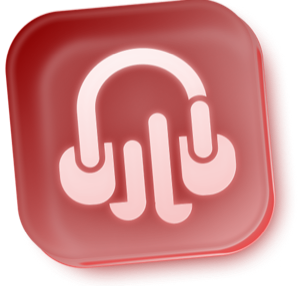

  

  

  Coming soon · macOS 26 or later

 

### Your song, always within reach

Squidd sits on your desktop in Liquid Glass, showing the album cover, song and artist, plus play, pause, skip and a seek bar. The pill above it can show the Squidd logo, the album cover, an animated mascot of your choice, or all three, and its rim glows while music plays.

Pick light or dark glass, recolor the logo and rim, and add a dashed outline or floating music notes. Press <kbd>⌃</kbd> <kbd>⌥</kbd> <kbd>⌘</kbd> <kbd>/</kbd> to tuck the player away and keep just the pill, or add the arrow keys to glide it around your screen.

Squidd talks to the Spotify or Music app already running on your Mac, so there’s no account to connect.
